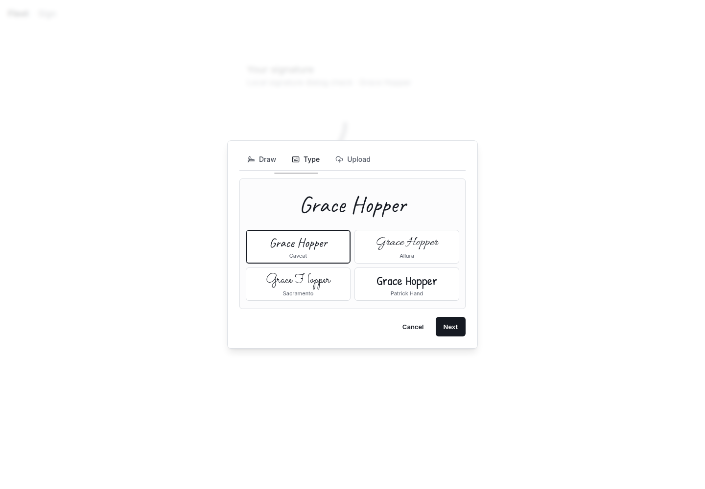
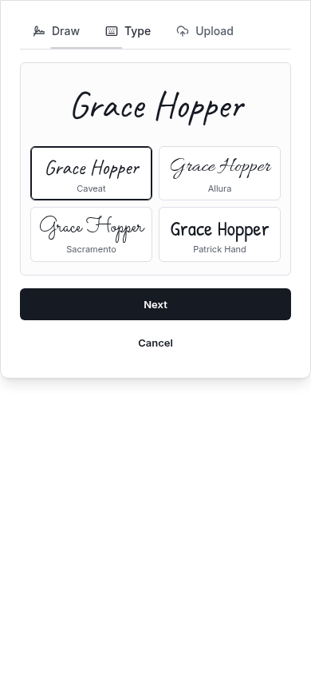
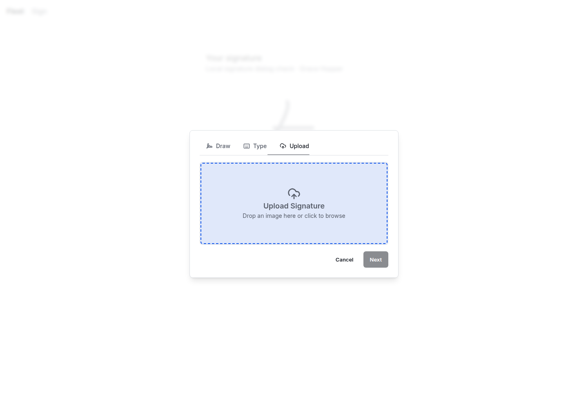

# Typed signature styles and image upload

Worktree: `/root/worktrees/sign-style`; branch `agent/c4a-sign`; unchanged HEAD `14a902451036ad9242a97e4d577bd07b7342921c`. No commit or deployment.

The Type tab now offers four labelled native radio choices, each previewing the entered name. Tab and arrow keys work. Only the font choice is saved in device-local storage (`sign.signature-style`); blocked storage falls back safely. Styling uses the existing theme/brand tokens.

`packages/fleet-ui/signature-styles.tsx` owns the picker, preference and renderer. The existing Type primitive supplies the name; the pad keeps the editable name separate from its rendered value. Caveat emits typed text. The other fonts wait for `document.fonts.load`, reject missing/failed font faces, render black ink on transparent PNGs, fit the native 16:7 pad at up to 1024×448, then trim to ink bounds with a small antialiasing gutter. Existing image rendering fits that PNG into each destination field without distortion. Pending/failed loads and blank names disable confirmation; superseded or unmounted renders cannot overwrite the current tab.

The upload primitive routes both dropped and selected files through `handleImageUpload(File)`, preserving the existing image-type, 5MB, dimensions and decode checks and error messages. The drop target has a visible theme-coloured highlight; its native button opens the chooser by click, Enter or Space. Existing image pan/zoom and replacement controls remain available.

No server, certificate, sealing, PDF, dependency manifest or lockfile changes. Real database checks confirm alternate styles populate `signatureImageAsBase64` and leave `typedSignature` null.

## Fonts

All four use SIL Open Font License 1.1. New binaries and complete licences are self-hosted in `apps/remix/public/chief/signature-fonts/`; CSS is in the existing `apps/remix/app/chief/fleet-documenso.css`. No runtime font CDN.

| Font | Appearance | Font file | Licence file under `signature-fonts/` |
| --- | --- | --- | --- |
| Caveat | Casual handwritten | Existing `apps/remix/public/fonts/caveat-variablefont_wght.ttf` | `caveat-OFL.txt` |
| Allura | Formal script | `apps/remix/public/chief/signature-fonts/Allura-Regular.ttf` | `allura-OFL.txt` |
| Sacramento | Looped monoline script | `apps/remix/public/chief/signature-fonts/Sacramento-Regular.ttf` | `sacramento-OFL.txt` |
| Patrick Hand | Upright handwriting | `apps/remix/public/chief/signature-fonts/PatrickHand-Regular.ttf` | `patrickhand-OFL.txt` |

Unmodified font binaries are pinned to [google/fonts commit 7af0d90](https://github.com/google/fonts/tree/7af0d90b4d532ffa4b041937b560c6df4e7b1e95/ofl); see [SOURCE.md](../../../apps/remix/public/chief/signature-fonts/SOURCE.md). The three new binaries total 541,100 bytes.

## Fork budget

`python3 /root/.hermes/cache/scratch/upcount.py d3b7f7c6` measured **20 files / 642 lines before**, rather than the task's stated 21 / 662. The worktree was clean at the specified HEAD; no baseline edits were removed.

Final count: **29 files / 772 added+deleted lines**, within S8.6's **30 / 822**. This includes this note, four screenshot paths (zero binary lines), and the six-line completion marker. To include untracked deliverables without staging them, measurement used a temporary `GIT_INDEX_FILE` and object directory, initialized from HEAD with intent-to-add entries. A plain counter invocation omits untracked files and reports **23 / 717**. Exclusions in `chief/spike/first-party-directories.txt` are unchanged: the picker/renderer, font assets, theme CSS and browser tests use the existing first-party directories.

## Verification

There is no unit-test harness for these React/DOM primitives; Vitest is reserved for pure functions. Playwright ran against a local, in-memory esbuild of the real dialog/primitives, real font files and existing theme CSS. A loopback test server invoked the unchanged signing route against a fresh migrated PostgreSQL 16 database. No application mocks or deployed services were used. This is component/route evidence, not a full signing-page or sealed-PDF walkthrough.

- **4/4 passed:** distinct transparent/trimmed black PNGs; keyboard choices and reload persistence; slow/failed fonts, blank input and tab-switch races; drop/click/Enter/Space pixel parity plus identical invalid-type, oversize and corrupt-image errors; real `signatureImageAsBase64` persistence and wrong-recipient denial without mutation.
- **Failing baseline:** rebuilding the primitives from HEAD fails both checks: zero style radios instead of four, and no drag-over state. Candidate passes both.
- **Passed:** `npm run typecheck -w @documenso/remix`; `node_modules/.bin/tsc --noEmit -p packages/ui/tsconfig.json`; Biome on all seven changed/new TypeScript files; `git diff --check`; `bash -n chief/inventory/e2e/sign-styles-run.sh`.
- Reproduce with `bash chief/inventory/e2e/sign-styles-run.sh` (local Docker, port 55497 free, installed Chromium). It scrubs the environment, creates/removes its own database, runs migrations without generating packages, then runs `CI=true` Playwright checks. The runner uses installed Playwright Chromium, with this workspace's cached Chromium 1223 as fallback.
- The temporary database and generated `.react-router` types were removed. Existing `node_modules` contents/symlinks were left unchanged. The browser bundle was kept in memory.

## Screenshots

Real dialog fixture, default tenant tokens, fictional signer; each image has exactly the requested viewport dimensions.

